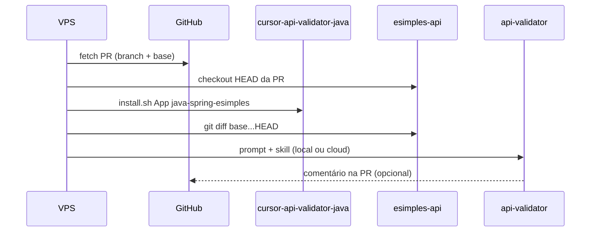

# Validação a partir de Pull Request

Fluxo para revisar **o diff da PR** com o `/api-validator`, sem duplicar padrões no repositório da API.

## Máquina local (sua rotina ao abrir a PR)

1. Cursor aberto na pasta **esimples-api**.
2. PowerShell na raiz do esimples-api:

```powershell
..\cursor-api-validator-java\scripts\local-review-pr.ps1 -Pr 123
```

Sem GitHub CLI: fique na branch da PR e rode só `local-review-pr.ps1` (sem `-Pr`).

3. Chat → `/api-validator` → cole `.api-validator-review/pr-123-prompt.md` (ou `branch-prompt.md`).

Isso faz checkout da PR (se `-Pr` + `gh`), `install` do pacote, diff vs `develop` e gera o prompt. O **agente validador** roda no Cursor; nada disso precisa estar commitado no esimples.

---

## Pré-requisitos (VPS ou CI)

| Item | Uso |
|------|-----|
| `git` | Checkout da branch da PR |
| [`gh`](https://cli.github.com/) (recomendado) | Metadados da PR, `gh pr checkout`, comentário opcional |
| Pacote **cursor-api-validator-java** | `install` com stack `java-spring-esimples` |
| Cursor (desktop), Cloud Agent ou SDK | Executar o agente com o prompt gerado |

Token: `GH_TOKEN` ou `gh auth login` com acesso ao repositório da API.

## Fluxo resumido



## Script (recomendado)

Na raiz do **pacote validador**:

### Linux / VPS

```bash
chmod +x scripts/review-pr.sh
./scripts/review-pr.sh \
  --app-dir /var/review/esimples-api \
  --pr 430 \
  --base develop \
  --stack java-spring-esimples
```

Gera em `<app-dir>/.api-validator-review/`:

- `pr-<n>-prompt.md` — cole no Cursor ou passe ao Cloud Agent
- `pr-<n>-diff.patch` — diff completo (referência)
- `pr-<n>-meta.json` — título, base, SHA, SPEC detectada

### Windows

```powershell
.\scripts\review-pr.ps1 -AppDir C:\review\esimples-api -Pr 430 -Base develop
```

## Depois do script: rodar o validador

1. Abra **só** a pasta da API (`esimples-api`) no Cursor — já com `.cursor/` instalado.
2. Chat → `/api-validator` e cole o conteúdo de `.api-validator-review/pr-<n>-prompt.md`, **ou** abra esse arquivo e peça ao agente seguir o prompt.

Exemplo manual (sem script), com `gh` já no repo da API:

```bash
cd esimples-api
gh pr checkout 430
../cursor-api-validator-java/install/install.sh "$(pwd)" java-spring-esimples
git fetch origin develop
git diff --stat origin/develop...HEAD
```

Prompt sugerido:

```text
/api-validator — PR #430, diff vs origin/develop.
SPEC: docs/SPEC.md na branch (se existir; senão corpo da PR).
Escopo ampliado se houver Contrato HTTP na SPEC ou na descrição da PR.
Seguir .cursor/agents/api-validator.md — somente relatório.
```

## O que a PR deve trazer

| Na PR | Efeito no validador |
|-------|---------------------|
| `docs/SPEC.md` na branch | Modo inteligente + aceite |
| Link ou texto `docs/SPEC-*.md` no corpo | Escopo explícito no prompt |
| Só código | **Gate enxuto** — só `git diff` vs base |

Convênio útil no template de PR do esimples:

```markdown
## Validação
- SPEC: docs/SPEC.md
- Base: develop
```

## CI (GitHub Actions) — push na PR dispara o validador

No **esimples-api**, workflow `.github/workflows/api-validator-pr.yml`:

- Eventos: `pull_request` → `opened`, **synchronize** (novo commit), `reopened`.
- Secret: `CURSOR_API_KEY`.
- Script: `scripts/ci-api-validator.py` + `scripts/requirements-ci.txt` neste pacote.
- **Windows / runner self-hosted:** o Python nativo não roda o SDK (`WinError 10038`). O workflow usa **WSL** (`ci-api-validator-cloud-wsl.ps1`). Pré-requisitos: [`wsl-windows-runner.md`](wsl-windows-runner.md) e `scripts/install-wsl-prereqs.ps1`.
- **Linux runner ou ubuntu GitHub:** `CURSOR_VALIDATOR_RUNTIME=cloud` direto. O agente clona a API no GitHub (`GITHUB_SHA` ou `HEAD`).
- **Máquina local:** `git push` da branch antes de `run-api-validator.cmd`.
- Comentário único na PR (tag `review`; corpo em `api-validator-report-public.md` — sem seção Conclusão); autor `review` com secret `REVIEW_BOT_TOKEN` ou `github-actions[bot]`; check falha se conclusão **NÃO APROVÁVEL** (qualquer item em Crítico ou Importante exige esse veredito; não há `APROVÁVEL COM RESSALVAS`).

Setup: ver `esimples-api/.github/workflows/README-api-validator.md`.

Template legado (só artefatos, sem modelo): [`templates/github-actions/api-validator-pr.yml`](../../templates/github-actions/api-validator-pr.yml).

## Comentários humanos na PR (contexto da validação)

O CI e o `review-pr` podem incluir **comentários e reviews de pessoas** no prompt (não bots, não o relatório `<!-- review -->`).

- Script: `scripts/pr_human_comments.py` (API GitHub).
- Token: `GITHUB_TOKEN` no Actions; localmente `gh auth login` ou `GITHUB_TOKEN` / `GH_TOKEN`.
- Artefato: `.api-validator-review/pr-<n>-discussion.md`.
- Desligar: `CURSOR_VALIDATOR_PR_COMMENTS=0`.
- Bots extras: `CURSOR_VALIDATOR_BOT_LOGINS=meu-bot,outro[bot]`.
- Limite de texto: `CURSOR_VALIDATOR_PR_COMMENTS_MAX_CHARS` (padrão 12000).

Discussão entra na **precedência de escopo** (combinado de negócio); o agente não deve reprovar por padrão genérico quando o comentário humano explica a intenção e o diff está alinhado. Achados continuam exigindo evidência no diff/SPEC; segurança/tenant crítico não é anulado por comentário.

## Comentário na PR

Após o relatório humano ou do agente:

```bash
gh pr comment 430 --repo ORG/esimples-api --body-file relatorio.md
```

Não commite `.api-validator-review/` na API (deve estar no `.gitignore` do app).
